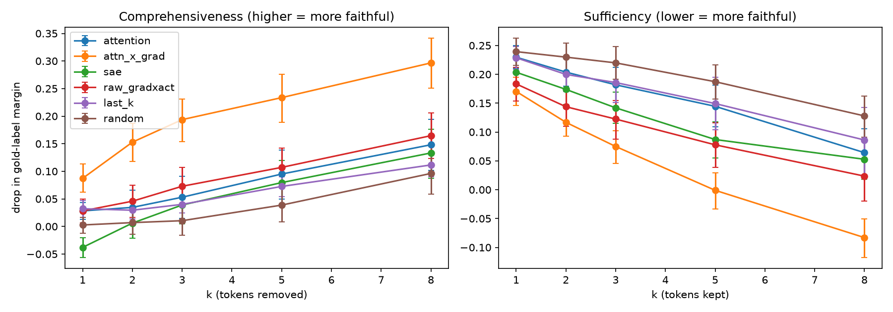
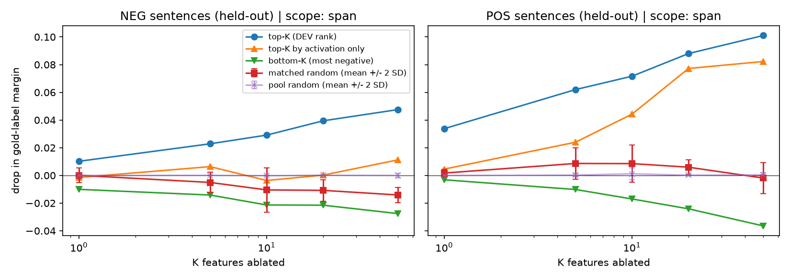

# SAE Features vs Attention Explanations: Faithfulness on GPT-2-small

*Numbers come from the completed run in `SAE.ipynb` (outputs in `results/` and `figures/`, N = 200, seed 0). Items marked `TODO` are manual inspection steps (Neuronpedia feature labels, case-study choice) that have not been done.*

## 1. Summary

I compared six token-importance explanations for GPT-2-small's few-shot sentiment predictions on SST-2: last-position attention, attention x gradient, gradient x activation through a layer-8 sparse autoencoder (SAE), raw gradient x activation, a last-k-tokens baseline and random ranking. Faithfulness was measured with ERASER-style comprehensiveness and sufficiency on 200 correctly classified sentences (100 per class). The SAE token score did **not** outperform plain attention on comprehensiveness (worse at k=1, indistinguishable at k = 2-8 after correction), but beat random on sufficiency at every k. Attention x gradient was the most faithful method overall (comprehensiveness 0.234 vs 0.080 for the SAE score at k=5). At feature level, ablating the top-K SAE features (ranked on a DEV half) reduced the margin on a held-out half more than matched random features, and a single difference-in-means direction removed more margin on positive sentences than 50 SAE features with a plain projection (0.123 vs 0.101) but less with a mean-centred projection (0.055). The results hold for one model, one layer, one SAE release, one prompt and a weak classifier.

## 2. Motivation

The "attention is / is not explanation" debate (Jain & Wallace, 2019; Wiegreffe & Pinter, 2019; Pruthi et al., 2020) shows that attention weights can disagree with gradient-based importance and that a faithfulness test is needed before trusting them. Sparse autoencoders (Cunningham et al., 2023; Bricken et al., 2023) offer a new decomposition of activations into features. The question here is narrow: for token-level explanations of one model on one task, does an explanation built from SAE features do better on removal-based faithfulness than attention-based explanations?

## 3. Setup

| Item | Value |
|---|---|
| Model | GPT-2-small (TransformerLens) |
| SAE | `gpt2-small-res-jb`, `blocks.8.hook_resid_pre`, 24,576 features |
| Task | 4-shot prompt; margin = logit(" positive") - logit(" negative") at the last position |
| Data | GLUE SST-2 validation (872 sentences) |
| Baseline accuracy | 0.658 overall; 0.935 on negative, 0.392 on positive; predicted-positive rate 0.232 (true rate 0.509) |
| Selection | correctly predicted, 10-40 sentence tokens (337 NEG and 155 POS candidates), 100 sampled per class, N = 200, mean 24.4 tokens |
| Prompt length | 79 prefix + sentence + 4 suffix tokens (<= 128, the SAE training context) |
| Seed | 0 |
| Hardware / versions | CPU; torch 2.14.0, transformer-lens 3.9.0, sae-lens 6.54.4, datasets 5.0.1, pandas 3.0.6, scipy 1.17.1, numpy 2.4.6 |

The mean gold-label margin of the evaluation set is 0.245, and the margin after blanking the whole sentence is about -0.005. The few-shot examples are original sentences written in SST-2 style (lowercase, spaced punctuation); the exact prompt is in the README. The classifier is weak and biased toward "negative"; only correctly predicted sentences are explained, so the positive set is the model's easy positives.

## 4. Methods

**Explanations** (score per sentence token, sentence tokens only):

- *Attention:* attention from the last prompt position to the token, averaged over all 12 layers and all heads.
- *Attention x gradient:* attention weight times d(margin)/d(attention weight) for the last-position row, summed over heads and layers (in the spirit of Serrano & Smith, 2019). Signed and label-aware.
- *SAE:* for the layer-8 residual stream, sum over SAE features of f(t,i) x d(margin)/d f(t,i). The forward pass is re-run with decode(f) + error, where error = residual - decode(encode(residual)) is held constant, so the patched pass equals the original (checked on every example, tolerance 0.01).
- *Raw grad x act:* x(t) . d(margin)/dx(t) on the raw layer-8 residual (control).
- *Last-k:* later tokens score higher (positional control).
- *Random:* 3 random rankings per sentence and k, averaged.

**Identity check.** With g = d(margin)/d(residual), the SAE score equals (x_hat - b_dec) . g and the raw score equals x . g, so they differ by (b_dec + error) . g. The identity held numerically (max difference 0.0 on three examples). It says nothing about how correlated the two scores are, so correlation was measured (Section 5.3).

**Faithfulness metrics.** Masking replaces the token embedding with the mean embedding vector (positional embeddings are unchanged; only sentence tokens are masked). Comprehensiveness = full margin - margin with the top-k tokens removed (higher = more faithful). Sufficiency = full margin - margin with everything except the top-k tokens removed (lower = more faithful). k in {1, 2, 3, 5, 8}. *Normalised* versions divide by (full margin - fully-blanked margin) and use only sentences where that gap exceeds 0.25 (97 of 200).

**Statistics.** 95% bootstrap CIs (2,000 resamples). Paired t-tests and Wilcoxon signed-rank tests on the same sentences, effect size dz, Bonferroni correction over 140 tests (5 values of k x 7 method pairs x 4 metrics).

**Feature-level test.** Even-numbered sentences (DEV; 49 NEG, 51 POS) rank features by mean gradient x activation contribution toward the gold label per class. Odd-numbered sentences (TEST; 51 NEG, 49 POS) are held out. For K in {1, 5, 10, 20, 50}, the top-K features are ablated inside the sentence span by subtracting f_i x W_dec[i] from the layer-8 residual (error term untouched) and compared with: bottom-K features, top-K by activation size only, K random active features, and K *matched* random features (similar activation mass; 5 draws). A non-SAE baseline removes one difference-in-means direction (DEV positive minus negative mean span residual) and compares with 15 directions built from label-shuffled DEV data. Both a plain projection and a mean-centred projection (removing only the part that varies around its DEV mean) are reported.

## 5. Results

### 5.1 Token-level faithfulness

Mean over sentences (95% bootstrap CI in `results/faithfulness_summary.csv`):

| method | comp k=1 | comp k=3 | comp k=5 | comp k=8 | suff k=1 | suff k=3 | suff k=5 | suff k=8 |
|---|---|---|---|---|---|---|---|---|
| attention | 0.028 | 0.053 | 0.095 | 0.148 | 0.230 | 0.182 | 0.145 | 0.064 |
| attention x gradient | 0.087 | 0.194 | 0.234 | 0.297 | 0.170 | 0.075 | -0.001 | -0.083 |
| SAE | -0.038 | 0.039 | 0.080 | 0.133 | 0.204 | 0.142 | 0.087 | 0.053 |
| raw grad x act | 0.028 | 0.073 | 0.107 | 0.165 | 0.183 | 0.122 | 0.078 | 0.024 |
| last-k | 0.032 | 0.040 | 0.073 | 0.112 | 0.229 | 0.186 | 0.149 | 0.086 |
| random | 0.003 | 0.010 | 0.039 | 0.096 | 0.239 | 0.220 | 0.187 | 0.128 |

AOPC-style average over k (comprehensiveness / sufficiency): attention 0.072 / 0.165, attention x gradient 0.193 / 0.056, SAE 0.044 / 0.132, raw 0.084 / 0.110, last-k 0.057 / 0.170, random 0.031 / 0.201. The normalised versions (97 sentences) rank the methods the same way at the top: attention x gradient 0.702 normalised comprehensiveness vs 0.371 attention, 0.332 raw, 0.262 SAE, 0.213 last-k, 0.185 random.

### 5.2 Paired tests (Bonferroni-adjusted over 140 tests)

| comparison (A vs B) | metric | result |
|---|---|---|
| SAE vs attention | comprehensiveness | k=1: A worse (dz = -0.43, p < 0.001); k = 2-8: no evidence of a difference (p = 1.0) |
| SAE vs attention | sufficiency | k=1: A slightly better (dz = -0.26, p = 0.041); k = 2-8: not significant |
| SAE vs random | comprehensiveness | k=1: A worse (dz = -0.30, p = 0.004); k=2: no difference; k = 3-8: A higher but not significant after correction (k=5: dz = 0.22, p = 0.37) |
| SAE vs random | sufficiency | A better at every k (k=5: mean difference -0.100, dz = -0.47, p < 0.001; k=8: p < 0.001) |
| attention vs random | comprehensiveness | A higher, not significant after correction (k=5: dz = 0.24, p = 0.10) |
| SAE vs raw grad x act | both | k=1 comprehensiveness: SAE worse (dz = -0.38, p < 0.001); otherwise not significant (normalised comprehensiveness at k=1 is also significant, p = 0.012) |
| SAE vs attention x gradient | comprehensiveness | SAE worse at every k (dz between -0.69 and -0.81, p < 0.001) |
| SAE vs attention x gradient | sufficiency | SAE worse from k=2 on (dz 0.34 to 0.58, p < 0.001); k=1 not significant |
| attention x gradient vs random | both | better at every k (comprehensiveness dz 0.59 to 1.02; sufficiency dz -0.50 to -0.85; p < 0.001) |

Direct tests of attention x gradient against plain attention and raw grad x act were not run (`TODO` if wanted for the write-up).

### 5.3 Agreement between explanations

Mean over sentences: Spearman(attention, SAE) = 0.095; Spearman(attention x gradient, SAE) = 0.418; Spearman(SAE, raw) = **-0.155**; top-1 agreement attention vs SAE = 0.50, SAE vs raw = 0.095; `resid_ratio` = mean |raw - SAE| / mean |raw| = 5.57. So the SAE token score and the raw score are not similar in this setup, even though they differ only by (b_dec + error) . g: that leftover term is large relative to the raw score. Why the terms are this large is not investigated here (`TODO` optional: decompose (x_hat - b_dec) . g and (b_dec + error) . g separately).

### 5.4 Case studies

`TODO`: inspect `figures/example_0.png`, `example_1.png`, `example_2.png` and pick 3-4 sentences. Candidates from the top-3-token table: sentence 0 ("i got a headache watching this meaningless downer .") where attention x gradient and the SAE both rank "headache" first, while attention ranks "." and raw grad x act ranks "a"; the "revoked" sentence where three methods rank "revoked" in their top 3. Punctuation tokens ("." "," "'") appear often among the SAE and attention top-3. This is a possible explanation for the SAE's weak comprehensiveness at k=1; it has not been tested.

### 5.5 Feature-level results

Top features per class on the DEV half (`results/top_features.csv`; the ranking is stable: 26/50 (NEG) and 39/50 (POS) of the top-50 features overlap between two DEV sub-halves, against about 0 expected by chance):

| class | feature | mean contribution | fires in | Neuronpedia label |
|---|---|---|---|---|
| NEG | 18337 | +0.018 | 49/49 | `TODO` |
| NEG | 18435 | +0.010 | 45/49 | `TODO` |
| NEG | 13119 | +0.006 | 49/49 | `TODO` |
| NEG | 14759 | +0.005 | 49/49 | `TODO` |
| NEG | 16396 | +0.003 | 49/49 | `TODO` |
| POS | 24129 | +0.057 | 50/51 | `TODO` |
| POS | 3967 | +0.032 | 51/51 | `TODO` |
| POS | 8169 | +0.030 | 51/51 | `TODO` |
| POS | 11788 | +0.016 | 51/51 | `TODO` |
| POS | 2387 | +0.012 | 50/51 | `TODO` |

Pages: `https://www.neuronpedia.org/gpt2-small/8-res-jb/<feature>`. `TODO`: read the top-activating examples of at least five features and write one honest sentence each (say "unclear" or "polysemantic" where that is true). Almost all of these features fire in nearly every sentence, which suggests dense, generic features rather than sentiment-specific ones; this needs the manual inspection to confirm.

Held-out ablation, drop in gold-label margin (mean margin of the set is 0.245):

| class | K | top-K | top-K by activation | bottom-K | matched random (mean) | top vs matched (dz) |
|---|---|---|---|---|---|---|
| NEG | 1 | 0.010 | -0.001 | -0.010 | 0.000 | 0.78 |
| NEG | 5 | 0.023 | 0.006 | -0.014 | -0.005 | 1.46 |
| NEG | 10 | 0.029 | -0.004 | -0.021 | -0.010 | 1.50 |
| NEG | 20 | 0.039 | 0.000 | -0.021 | -0.011 | 1.78 |
| NEG | 50 | 0.048 | 0.011 | -0.028 | -0.014 | 1.91 |
| POS | 1 | 0.034 | 0.005 | -0.003 | 0.002 | 2.49 |
| POS | 5 | 0.062 | 0.024 | -0.010 | 0.009 | 2.36 |
| POS | 10 | 0.072 | 0.044 | -0.017 | 0.009 | 2.61 |
| POS | 20 | 0.088 | 0.077 | -0.024 | 0.006 | 2.84 |
| POS | 50 | 0.101 | 0.082 | -0.036 | -0.002 | 2.92 |

Top-K features reduced the held-out margin more than matched random features in every row; bottom-K features moved the margin the other way. The absolute effects are small (at most 0.10 logits, about 40% of the mean margin, for POS at K=50). For POS sentences, picking features by activation size alone recovers most of the effect (0.077 vs 0.088 at K=20); for NEG sentences it does not.

**Direction baseline** (one rank-1 direction vs 15 label-shuffled null directions, span scope):

| class | n | plain drop | null mean | null SD | dz vs null | p | centred drop | centred null mean |
|---|---|---|---|---|---|---|---|---|
| NEG | 51 | -0.017 | -0.002 | 0.015 | -0.38 | 0.009 | 0.037 | 0.001 |
| POS | 49 | 0.123 | -0.006 | 0.025 | 2.16 | < 0.001 | 0.055 | -0.001 |

With the plain projection, one direction removed more margin (0.123) than 50 SAE features (0.101) on POS sentences and slightly increased the margin on NEG sentences. The plain projection also removes the class-independent component along the direction. With the mean-centred projection the NEG anomaly disappears (0.037) and the POS effect falls to 0.055, below the top-50 SAE features, so much of the plain effect came from this shared offset. The earlier hypothesis about the model's negative bias is therefore not needed to explain the NEG result.

**SAE reconstruction fidelity.** Splicing the SAE reconstruction in place of the layer-8 residual (error term dropped) on 100 sentences: mean margin 0.220 vs 0.228 originally, but only 68% remain correct. Splicing at all non-BOS positions (BOS left untouched) gave the same fraction (68%, mean margin 0.221), so the loss is not caused by BOS.

## 6. Interpretation

- **Token level.** Within this setup, the SAE token score is not a better explanation than last-position attention on comprehensiveness, and it is worse at k=1. It does beat random on sufficiency. A gradient score that goes through the attention weights (attention x gradient) was clearly more faithful than both. Because that score is signed and label-aware, and attention and the SAE score computed here are not equally informed about the label, this comparison is not a statement that gradients beat attention in general.
- **SAE vs raw.** The SAE token score is not close to raw gradient x activation here (Spearman -0.155), so the identity in Section 4 is exact but should not be read as "the two are the same explanation".
- **Feature level.** Gradient-ranked SAE features do have a causal effect beyond matched random features on held-out sentences, with small absolute size. The effect for POS sentences is largely reproduced by choosing features by activation alone, and with a plain projection one diff-in-means direction exceeded 50 features on POS sentences (0.123 vs 0.101) but not with a mean-centred projection (0.055); these results do not show that SAE features isolate sentiment better than simpler directions.
- **Reconstruction.** Because only 68% of correct predictions survive splicing, conclusions that depend on the SAE reconstruction alone are weak; that is why the error term is kept.

## 7. Limitations

- One model, one layer, one SAE release, one task, one prompt; a weak few-shot classifier (accuracy 0.658, positive-class accuracy 0.392, mean margin 0.245) with a negative bias.
- Only correctly predicted sentences are explained.
- Removal-based metrics use out-of-distribution inputs (blank embeddings); methods are masked identically, so comparisons stay meaningful, but absolute values do not. Other masking schemes were not tried.
- Attention is read only at the last position and averaged uniformly over layers and heads; per-layer, per-head and rollout variants were not run.
- The SAE attribution is a first-order approximation; the SAE and attention x gradient scores are label-aware while plain attention is not.
- Normalised metrics use 97 of 200 sentences (those with a larger margin gap).
- The feature ablation was run for the sentence-span scope only (an "all positions" scope can be added to `SCOPES` in the notebook but was not run); the direction baseline is rank-1 and compared with K-feature sets, not with a rank-K baseline.
- With 51 / 49 held-out sentences per class, per-class estimates are noisy; Bonferroni was applied to token-level tests only, not to the feature-level tests.
- The SAE and raw gradient x activation scores are taken at the layer-8 residual stream of the sentence positions (influence through layers 8-11 only), whereas attention x gradient sums over all 12 layers and faithfulness is measured by blanking input embeddings; embedding-level gradient x input and occlusion baselines were not run.
- The SAE library recommends loading the model without weight processing (`from_pretrained_no_processing`); this run used the default processing, which may add to the reconstruction error (not tested).
- No feature has been interpreted yet (`TODO`).

## 8. Reproducibility

Run `SAE.ipynb` from the repo root with `QUICK = False`. The exact sentences are in `data/selected_examples.csv`; all tables are in `results/`; `results/run_info.json` stores seed, settings, prompt and library versions. A CPU run takes hours and checkpoints every 25 sentences.

## References

Jain & Wallace (2019), arXiv:1902.10186. Wiegreffe & Pinter (2019), arXiv:1908.04626. Pruthi et al. (2020), arXiv:1909.07913. Serrano & Smith (2019), arXiv:1906.03731. DeYoung et al. (2020), arXiv:1911.03429. Cunningham et al. (2023), arXiv:2309.08600. Bricken et al. (2023), *Towards Monosemanticity*. Hooker et al. (2019), arXiv:1806.10758. Tigges et al. (2023), arXiv:2310.15154.